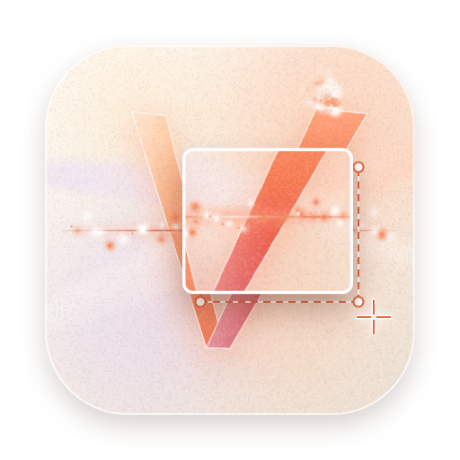
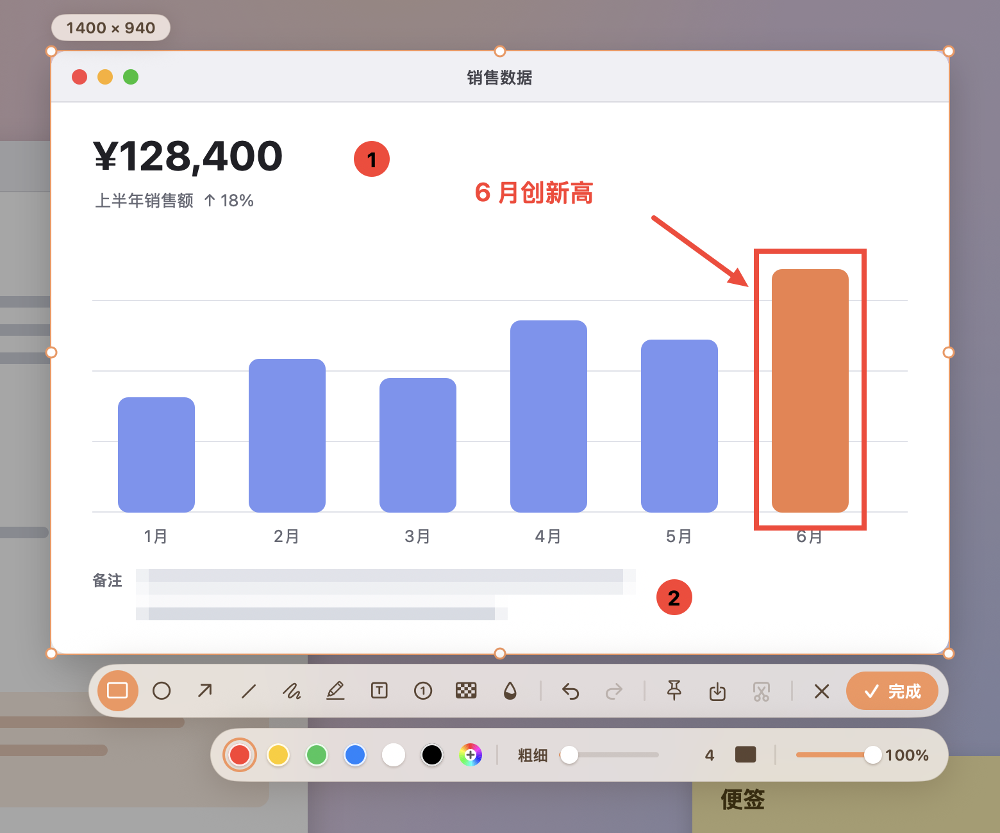
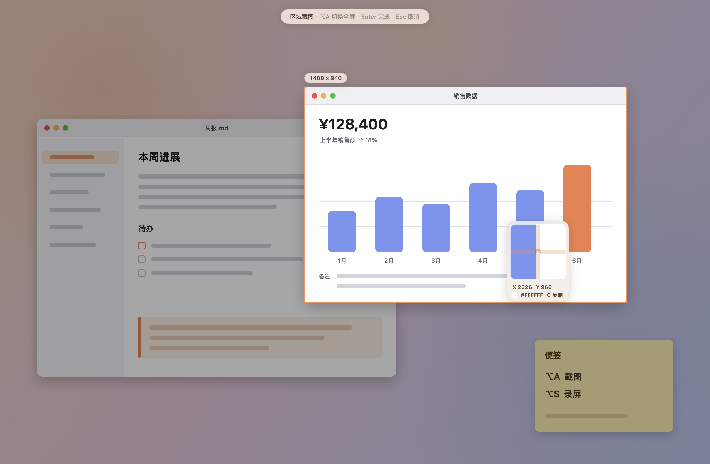
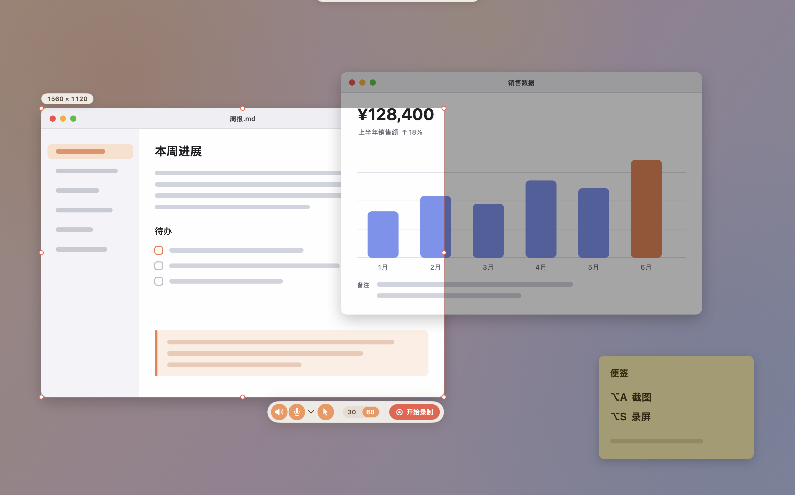
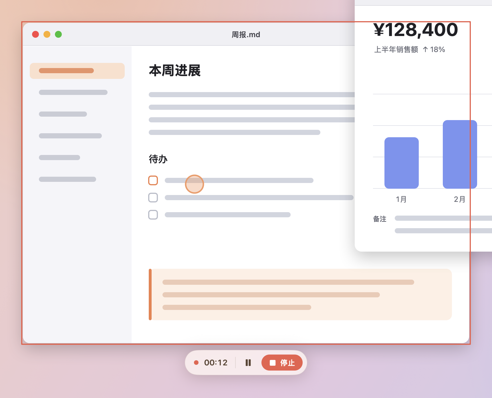
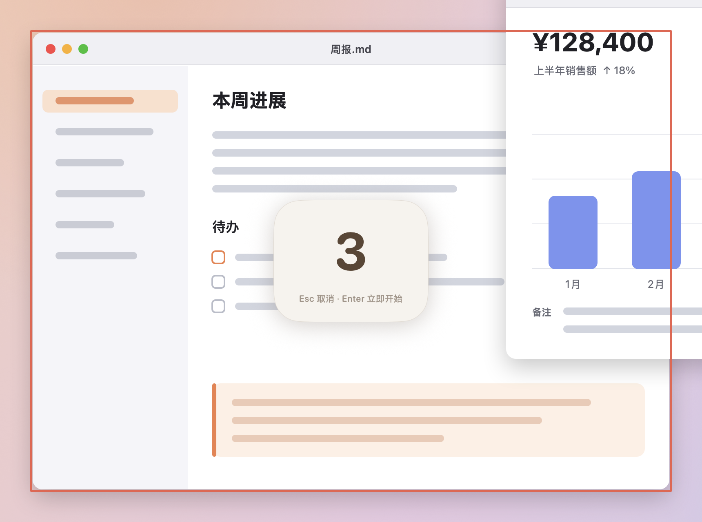
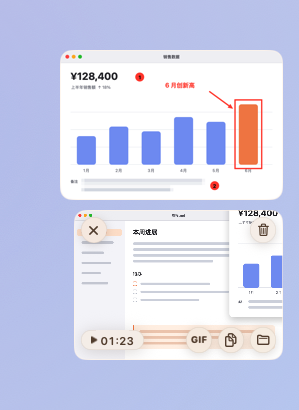
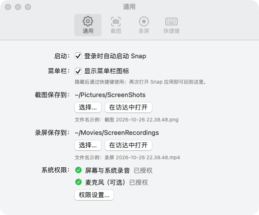
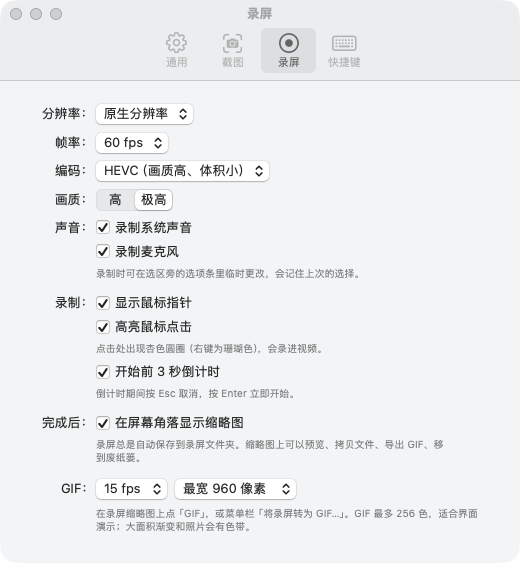
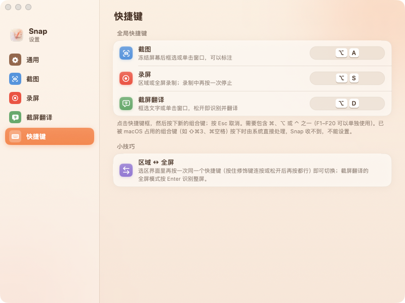

<p align="center">
  
</p>

<h1 align="center">Snap</h1>

<p align="center">
  轻量、原生的 macOS 截图、录屏与截屏翻译工具<br>
  4.7 MB · 空闲内存约 14 MB · 默认不联网 · 不收集任何数据 · 无第三方依赖
</p>

<p align="center">
  <a href="https://github.com/SkuraSshly/Snap/releases/latest"><b>下载</b></a> ·
  <a href="#快捷键">快捷键</a> ·
  <a href="docs/使用说明.md">使用说明</a> ·
  <a href="docs/卸载说明.md">卸载说明</a>
</p>

<p align="center">
  
</p>

## 特点

- **一键截图**：<kbd>⌥A</kbd> 冻结画面后框选，自动识别窗口，放大镜精确到像素；再按一次 <kbd>⌥A</kbd> 切换全屏。
- **原位标注**：矩形、椭圆、箭头、直线、画笔、荧光笔、文字、序号、马赛克、模糊，支持撤销 / 重做。
- **钉图**：把截图钉在屏幕最上层，可缩放、调透明度，方便对照。
- **高质量输出**：Retina 原生像素，写入色彩配置文件（Display P3 / sRGB），PNG / HEIC / JPEG。
- **录屏**：<kbd>⌥S</kbd> 区域或全屏；HEVC / H.264 硬件编码；系统声音与麦克风实时混成一条 AAC 音轨；暂停时那一段不进视频。
- **录制辅助**：3 秒倒计时、鼠标点击高亮、浮动控制条、红框标出录制范围（控制条和红框都不会被录进去）。
- **截屏翻译**：<kbd>⌥D</kbd> 框选后离线识别文字（Vision），用 Apple 翻译离线翻译，译文逐段显示；单个单词查 macOS 自带词典；结果窗口可钉住、多开、朗读。可选在线引擎（有道、DeepL、微软、百度、腾讯、火山、OpenAI 兼容大模型、Claude），默认全部关闭，Key 存在钥匙串里。
- **GIF 导出**：自带流式 GIF 编码器，边转边写文件，内存占用很低（3 秒的 2560×1440 全屏录屏转成 960 宽的 GIF 不到 1 秒）。
- **轻量**：常驻菜单栏，空闲时不运行任何屏幕采集，CPU 为 0。

## 截图预览

<table>
  <tr>
    <td width="50%"><br><sub><b>截图</b>：悬停自动识别窗口，放大镜显示像素和颜色值</sub></td>
    <td width="50%"><br><sub><b>标注</b>：选好区域直接标注，工具栏在选区下方</sub></td>
  </tr>
  <tr>
    <td><br><sub><b>录屏选区</b>：选项条上切换系统声音、麦克风、鼠标指针、帧率</sub></td>
    <td><br><sub><b>录制中</b>：红框标出范围，控制条可暂停、停止；点击处出现高亮圆圈</sub></td>
  </tr>
  <tr>
    <td><br><sub><b>倒计时</b>：开始前倒数 3 秒，Esc 取消、Enter 立即开始</sub></td>
    <td align="center"><br><sub><b>缩略图</b>：完成后出现在角落，可拖进任何 App；录屏可预览、导出 GIF</sub></td>
  </tr>
</table>

<table>
  <tr>
    <td width="33%"></td>
    <td width="33%"></td>
    <td width="33%"></td>
  </tr>
</table>

> 预览图里的「桌面」是 Snap 的调试模式自己画的演示画面（见下文「开发」），不是真实屏幕。

## 安装

需要 **macOS 15 或更新**、**Apple 芯片**的 Mac。

1. 在 [Releases](https://github.com/SkuraSshly/Snap/releases/latest) 下载 `Snap-1.0.0.dmg`，打开后把 Snap 拖进「应用程序」。
2. 打开 Snap。第一次运行会出现权限引导：
   - **屏幕与系统录音**（必需）：截图、录屏都需要。授权后按提示重新打开 Snap。
   - **麦克风**（可选）：只在录屏时录自己的声音才需要。

> **第一次打开被 macOS 拦下？** 这个版本没有使用 Apple 开发者证书签名、也没有经过公证，
> macOS 会提示「无法验证开发者」。到 **系统设置 › 隐私与安全性**，在页面下方点 **「仍要打开」** 即可，只需一次。
> 也可以按下文自己从源码构建，本机构建的版本不会被拦。

## 快捷键

| 场合 | 按键 | 作用 |
|---|---|---|
| 任何时候 | <kbd>⌥A</kbd> | 截图 |
| 任何时候 | <kbd>⌥S</kbd> | 录屏；录制中再按一次停止 |
| 任何时候 | <kbd>⌥D</kbd> | 截屏翻译 |
| 截图 / 录屏选区 | 再按 <kbd>⌥A</kbd> / <kbd>⌥S</kbd> | 在「区域 ↔ 全屏」之间切换 |
| 截图界面 | <kbd>Enter</kbd> | 完成（复制到剪贴板、显示缩略图） |
| 截图界面 | <kbd>⌘S</kbd> | 完成并保存到文件 |
| 截图界面 | <kbd>⌘Z</kbd> / <kbd>⇧⌘Z</kbd> | 撤销 / 重做 |
| 截图界面 | <kbd>C</kbd> | 拷贝放大镜下的颜色值 |
| 截图 / 录屏选区 | 方向键（<kbd>⇧</kbd> + 方向键） | 微调选区 1 像素（10 像素） |
| 翻译结果窗口 | <kbd>⌘C</kbd> / <kbd>⇧⌘C</kbd> | 复制译文 / 原文 |
| 翻译结果窗口 | <kbd>⌘R</kbd> / <kbd>⌘P</kbd> / <kbd>Esc</kbd> | 重新翻译 / 钉住 / 关闭 |
| 截图 / 录屏选区 | <kbd>Esc</kbd> | 取消 |
| 钉图 | 单击选中后 <kbd>Esc</kbd> 或双击 | 关闭钉图 |
| 钉图 | 滚轮 / <kbd>⌘</kbd> + 滚轮 | 缩放 / 调整透明度 |

快捷键可以在 设置 › 快捷键 里修改，并会检查冲突（常用编辑快捷键、macOS 系统快捷键、Snap 自己的另一个快捷键）。

## 文件保存在哪

| 内容 | 默认位置 | 何时写入 |
|---|---|---|
| 截图 | `~/Pictures/ScreenShots` | 点缩略图上的「保存」或按 <kbd>⌘S</kbd> 时 |
| 录屏 | `~/Movies/ScreenRecordings` | 录制时自动写入 |
| GIF | 与对应的录屏放在一起 | 点「GIF」导出时 |

位置可以在 设置 › 通用 里修改。Snap 写到电脑上的全部内容见 [卸载说明](docs/卸载说明.md)。

## 隐私

- **默认不联网**：截图、录屏、文字识别、Apple 翻译、查词都在本机完成。只有你在设置里启用并填了 Key 的在线翻译引擎，才会把要翻译的文字发给那家服务商（不发截图）。不检查更新，不上报崩溃，没有统计。
- **不读取你不让它读的东西**：只在你按下截图 / 录屏快捷键之后才采集屏幕，空闲时没有任何屏幕采集在运行。
- 运行日志写在系统日志里，只有操作和参数（例如「开始录制：2560×1440，60 fps」），不含任何画面或声音内容。

## 已知限制

- macOS 会定期弹出「Snap 正在访问你的屏幕」的确认框（大约每月一次或系统更新后），这是 macOS 对所有录屏类 App 的系统行为。
- 已被 macOS 占用的组合键（如 <kbd>⇧⌘3</kbd>）按下时由系统直接处理，不能设为 Snap 的快捷键。
- 菜单栏菜单、钉图右键菜单是系统原生菜单，样式无法自定义。
- GIF 每帧最多 256 色，大面积渐变和照片会有色带。
- 用蓝牙耳机的麦克风录音时，macOS 会把耳机切到通话模式，系统声音的音质随之下降。

## 从源码构建

只需要 Xcode 命令行工具（`xcode-select --install`），不需要完整的 Xcode，也没有任何第三方依赖。

```bash
git clone https://github.com/SkuraSshly/Snap.git
cd Snap
./build.sh          # 编译 release 版，生成 build/Snap.app
open build/Snap.app
```

| 命令 | 作用 |
|---|---|
| `./build.sh` | 编译 release 版，生成 `build/Snap.app` |
| `./build.sh debug` | 编译调试版（包含自测代码） |
| `./run.sh` | 编译并重新启动 Snap |
| `./package.sh` | 打包成 `dist/Snap-版本号.dmg` 和 `.zip` |

本机构建使用 ad-hoc 签名，并把签名的「指定要求」设为 bundle id，重新编译后已授予的屏幕录制权限依然有效。

## 开发

源码在 `Sources/Snap`，按功能分文件夹：

| 文件夹 | 内容 |
|---|---|
| `Capture` | 快捷键调度、冻屏 |
| `Overlay` | 选区界面：窗口识别、控制点、放大镜、提示条 |
| `Screenshot` · `Annotation` · `Pin` | 截图输出、标注、钉图 |
| `Recording` | 录屏引擎、实时混音、控制条、倒计时、点击高亮、GIF 编码 |
| `Thumbnail` | 截图 / 录屏完成后的缩略图 |
| `Hotkeys` · `MenuBar` · `Settings` · `Permissions` | 全局快捷键与冲突检测、菜单栏、设置、权限引导 |
| `UI` | 温暖磨砂风格的控件 |

调试版内置自测（测试中改动的设置会恢复）：

| 环境变量 | 内容 |
|---|---|
| `SNAP_UITEST=目录` | 截图界面：在合成画面上走一遍所有交互（不读取真实屏幕） |
| `SNAP_RECTEST=目录` | 录屏：混音、音轨、暂停、音画同步、控制条、缩略图。会真实录制屏幕左下角一小块几秒钟（只核对文件参数和声音响度，测完删除），并播放一声系统提示音 |
| `SNAP_FEATURETEST=目录` | 快捷键冲突、倒计时、点击高亮、GIF 导出等 |
| `SNAP_SHOWCASE=目录` | 生成本页的预览图（演示桌面 + 只截取 Snap 自己的窗口） |

例如：`open --env SNAP_UITEST=/tmp/snaptest build/Snap.app`（先 `./build.sh debug`），结果写在 `result.txt`。

App 图标由 `scripts/make-icon.swift` 用代码绘制生成。

## 卸载

见 [卸载说明](docs/卸载说明.md)：列出了 Snap 在电脑上留下的全部内容和删除方法。

## 许可证

[MIT](LICENSE)。第三方声明见 [THIRD_PARTY_NOTICES.md](THIRD_PARTY_NOTICES.md)（没有第三方代码和依赖）。
