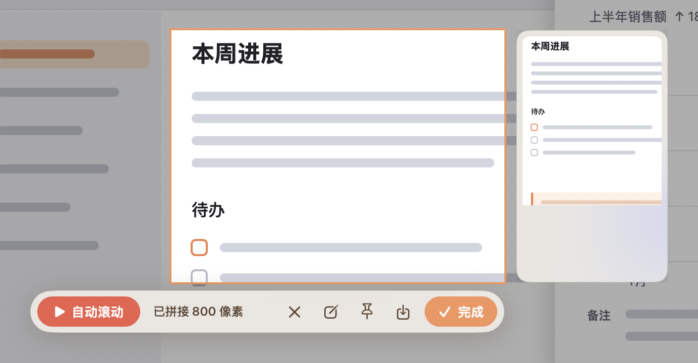
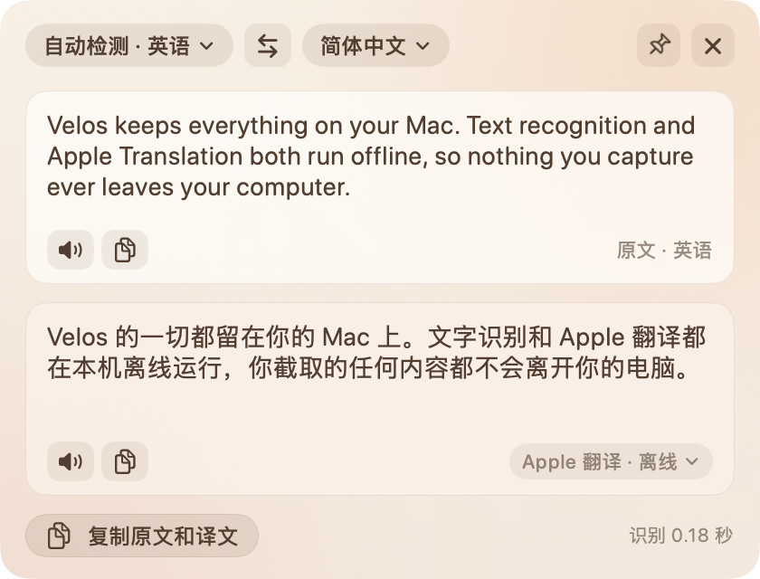

<p align="center">
  
</p>

<h1 align="center">Velos</h1>

<p align="center">
  原生、轻巧的 macOS 截图工具：截图标注、长截图、录屏、截屏翻译<br>
  <sub>下载约 4 MB · 空闲内存约 14–50 MB · 默认不联网 · 不收集任何数据 · 没有第三方依赖</sub>
</p>

<p align="center">
  <a href="https://github.com/SkuraSshly/Velos/releases/latest"><b>下载</b></a> ·
  <a href="docs/使用说明.md">使用说明</a> ·
  <a href="docs/更新说明.md">更新说明</a> ·
  <a href="docs/卸载说明.md">卸载说明</a>
</p>

<table align="center">
  <tr>
    <td align="center"><a href="docs/images/settings-general.png"></a><br><sub><b>设置</b>：温暖、一目了然</sub></td>
    <td align="center"><a href="docs/images/screenshot-annotate.png"></a><br><sub><b>截图</b>：框选后在原位标注</sub></td>
  </tr>
</table>
<table align="center">
  <tr>
    <td align="center"><a href="docs/images/long-capture.png"></a><br><sub><b>长截图</b>：边滚边拼，旁边实时预览</sub></td>
    <td align="center"><a href="docs/images/recording-controls.png"></a><br><sub><b>录屏</b>：控制条和红框不录进视频</sub></td>
    <td align="center"><a href="docs/images/translate.png"></a><br><sub><b>截屏翻译</b>：松开鼠标就出结果</sub></td>
  </tr>
</table>
<p align="center"><sub>点击图片查看大图</sub></p>

Velos（βέλος）在希腊语里是「箭」——像箭一样快、准地截下屏幕上的东西。

## 能做什么

| | |
|---|---|
| **截图** <kbd>⌥A</kbd> | 冻结画面后框选，悬停自动识别窗口，放大镜精确到像素。直接在原位标注：矩形、椭圆、箭头、画笔、文字、序号、马赛克、模糊……可以截圆角图。完成后复制、保存、钉在屏幕上，或打开编辑窗口继续改。 |
| **长截图** | 框选后点工具栏的剪刀按钮，滚动页面，Velos 边滚边拼接；标题栏、输入框只出现一次；不改动你的滚动（鼠标、触控板、滚动工具都照常），滚得太快跟丢时自动接回；也可以点「自动滚动」让它匀速慢慢滚。 |
| **录屏** <kbd>⌥S</kbd> | 区域或全屏，系统声音和麦克风混成一条音轨，可暂停；倒计时、点击高亮、导出 GIF。录制中照样能截图、翻译，并一起录进视频。 |
| **截屏翻译** <kbd>⌥D</kbd> | 框选文字，离线识别、用 Apple 翻译离线翻译；单个单词查系统词典。也可以接入自己的翻译服务（腾讯、火山、百度、DeepL、OpenAI 兼容大模型等）。 |

## 安装

需要 **macOS 15 或更新**、**Apple 芯片**的 Mac。

1. 在 [Releases](https://github.com/SkuraSshly/Velos/releases/latest) 下载 `Velos-2.4.2.dmg`，把 Velos 拖进「应用程序」。
2. 打开 Velos，按引导打开 **屏幕与系统录音** 权限（必需）。麦克风（录自己的声音）、辅助功能（长截图的自动滚动）用到时再开。

> 这个版本没有 Apple 开发者证书签名和公证，第一次打开时 macOS 会拦下。到 **系统设置 › 隐私与安全性**，在页面下方点 **「仍要打开」**，只需一次。
>
> 用过旧版 Snap？Velos 就是改名后的 Snap，第一次打开会自动搬来原来的设置。

快捷键都可以在设置里改，全部快捷键和用法见 [使用说明](docs/使用说明.md)。

## 隐私

- 截图、录屏、文字识别、Apple 翻译、查词都在本机完成，默认不联网。
- 只有你在设置里启用并填了 Key 的翻译服务，才会把要翻译的文字（不是截图）发给那一家。Key 只存在本机钥匙串里。
- 不检查更新、不上报崩溃、没有统计；空闲时不运行任何屏幕采集。

## 从源码构建

只需要 Xcode 命令行工具（`xcode-select --install`），没有任何第三方依赖。

```bash
git clone https://github.com/SkuraSshly/Velos.git
cd Velos
./build.sh            # 生成 build/Velos.app
open build/Velos.app
```

| 命令 | 作用 |
|---|---|
| `./test.sh` | 单元测试（拼接、GIF 编码、快捷键、翻译引擎签名、文字识别等纯逻辑），几秒完成，不启动 App |
| `./build.sh debug` | 调试版，内含界面流程自测（`VELOS_UITEST`、`VELOS_RECTEST`、`VELOS_FEATURETEST` 等环境变量） |
| `./run.sh` | 编译并重新启动 |
| `./package.sh` | 打包成 `dist/Velos-版本号.dmg` 和 `.zip` |

源码在 `Sources/Velos`（按功能分文件夹），文字识别在 `Sources/VelosOCRKit`，由单独的识别服务进程 VelosOCR 调用；设置窗口在子进程 VelosSettings 里打开（同一份程序，见 `Sources/Velos/App/SettingsProcess.swift`），两者用完 30 秒后自己退出。App 图标由 `scripts/make-icon.swift` 用代码绘制。

## 许可证

[MIT](LICENSE)
